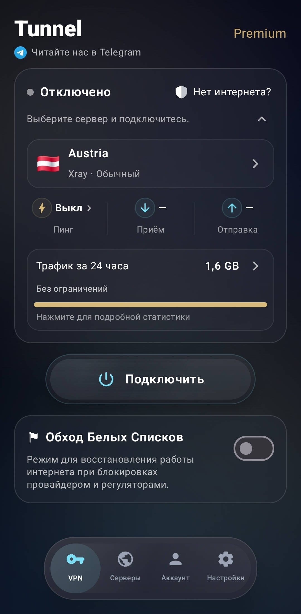
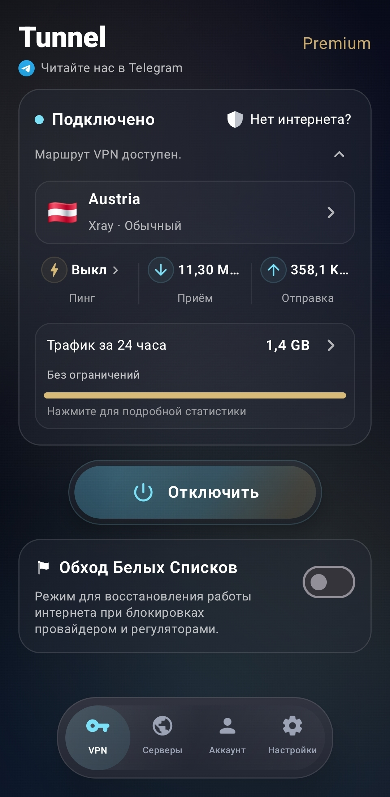
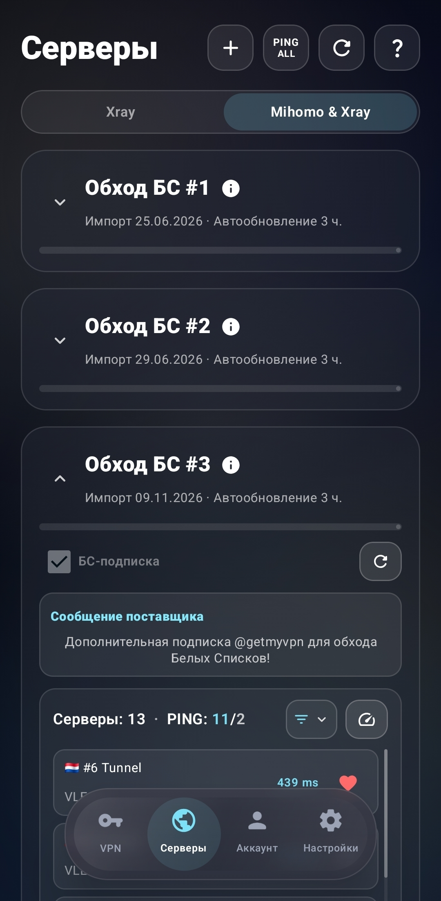
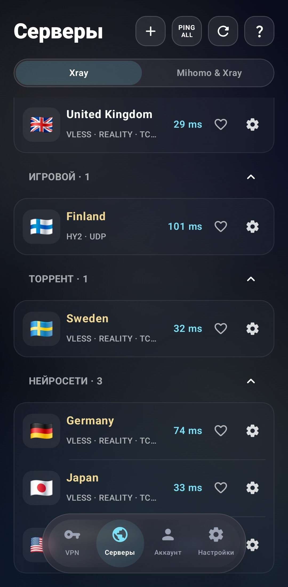
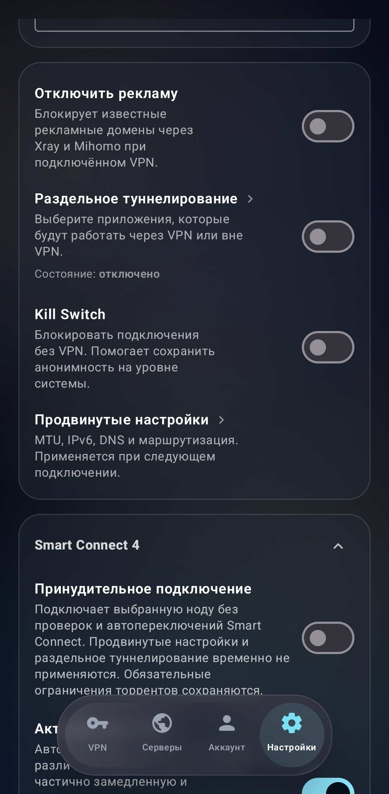
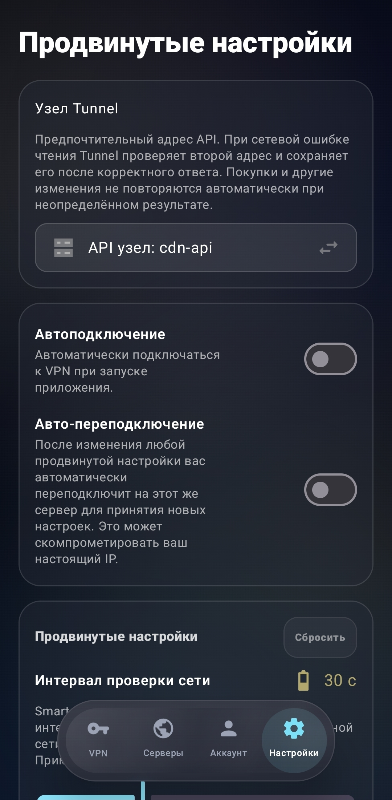
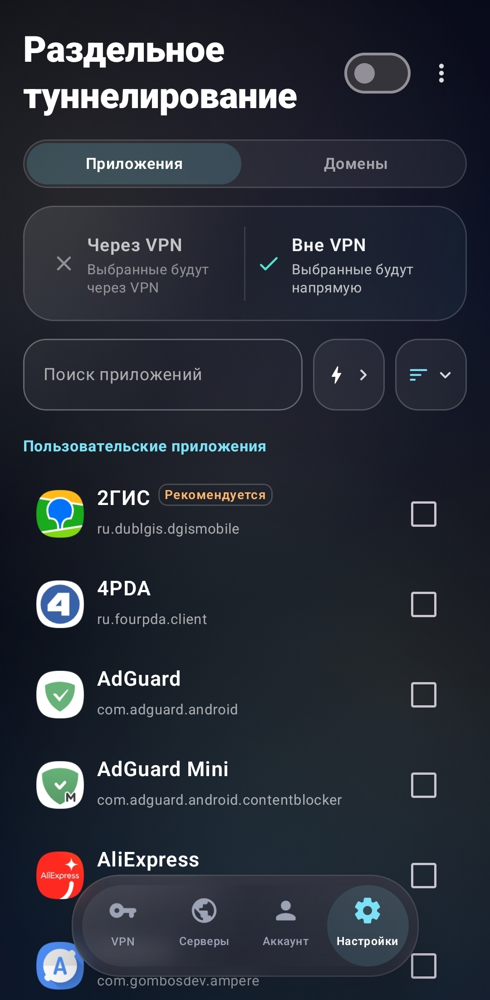
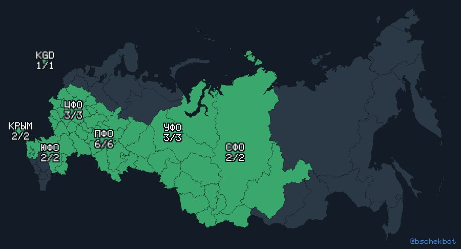

<p align="center">
  
</p>

<h1 align="center">Tunnel</h1>

<p align="center">
  <b>Не просто приложение для подписок и конфигов. Tunnel помогает найти рабочее подключение там, где обычные VPN часто не справляются.</b>
</p>

<p align="center">
  Xray / Mihomo / AWG / HEV · Сервера уже внутри · подписки и личные конфигурации <br/>· fallback · DPI / whitelist-oriented logic · Smart Connect 4.0<br /><br />
  <b>Протестировано в режимах Белых Списков в Московской Области, Удмуртии, Самарской Области, Волгограде, Туапсе, Ростове-на-Дону, Пскове, Владивостоке и других регионах. Подробности ниже.</b><br />
</p>

<p align="center">
  
  
  
  
  
  
  
</p>

---

## О проекте

**Tunnel** — приложение для управления туннелированием на базе **Xray, Mihomo, AWG**, ориентированное на стабильную работу в сетях с ограничениями, DPI и whitelist-фильтрацией.

Проект объединяет автоматическую выдачу конфигураций, привязку доступа к аккаунту, серверы из подписок, Белые Списки, резервные маршруты, избранные серверы, игнорирование туннелирования для отдельных приложений и автоматическое восстановление подключения при сетевых сбоях.

Главная идея Tunnel — не просто подключить пользователя к VPN, а сохранить доступ к интернету даже в условиях агрессивной фильтрации трафика.

Мы успешно пережили все последние массовые РКН-блокировки и не собираемся останавливаться.

---

## Интерфейс приложения

<p align="center">
  
  
  
  
  </p><p align="center">
  
  
  
</p>

---

## Почему Tunnel

Обычные VPN-клиенты часто требуют ручной настройки, плохо адаптируются к фильтрации трафика и не рассчитаны на централизованное управление доступом.

**Tunnel** решает эту проблему за счёт:
- автоматического получения и обновления конфигураций;
- привязки конфигов к аккаунту пользователя;
- поддержки личных серверов, URL-подписок и полных Clash/Mihomo-профилей;
- проверки доступности серверов;
- аварийного переключения между маршрутами;
- учёта работы серверов в условиях DPI и whitelist-фильтрации;
- Smart Connect, который учитывает состояние сети и сценарий запуска;
- исключения отдельных приложений из VPN/TUN;
- интерфейса, рассчитанного на ежедневное использование, а не только на ручную настройку протоколов.

---

## Почему это не обычный Xray-клиент

Большинство Xray/VLESS-клиентов работают как конфигураторы: пользователь сам ищет конфиг, вставляет ссылку, проверяет серверы и разбирается, почему подключение не работает.

Tunnel строится иначе:

| Обычные клиенты (Incy, Happ, V2rayNG, KaringX, FlClashX и т.д.) | Tunnel |
|---|---|
| Пользователь сам ищет конфиг, пользователю нужен VPN, чтобы оплатить в боте Телеграм подписку | Готовые маршруты уже внутри приложения, не нужен VPN для получения каталога серверов |
| Серверы проверяются вручную, нет возможности выбрать избранные или исключить нежелательные локации | Есть проверка доступности серверов, функционал избранных и нежелательных серверов |
| При сбое пользователь разбирается сам | Есть failover-логика: Tunnel подбирает следующий подходящий маршрут |
| Стандартная подписочная модель | Поддерживаются отдельные ноды и полные Clash/Mihomo-профили, собственные параметры совместимости (см. подробнее ниже) |
| Интерфейс часто технический, непонятный | Упор на современный мобильный UX, минимум действий пользователя |
| Главный сценарий — импорт конфига | Главный сценарий — найти рабочее подключение любым способом |

---

## Возможности

- **Автоматическое получение конфигураций**  
  Приложение может получать и обновлять доступные конфиги без ручного копирования.

- **Привязка конфигураций к аккаунту**  
  Конфиги связываются с аккаунтом пользователя и управляются централизованно.

- **Аварийное переключение**  
  При проблемах с подключением приложение может попробовать перейти на другой подходящий сервер. Особенно актуально при усиленных блокировках и нестабильной мобильной сети.

- **Работа с DPI и whitelist-фильтрацией**  
  Tunnel ориентирован на сценарии, где обычное VPN-подключение может быть нестабильным из-за фильтрации трафика. Для этого используются Белые Списки, Smart Connect и отдельная логика восстановления маршрута.

- **Smart Connect**  
  Smart Connect помогает отличать обычное подключение, нестабильную сеть, потерю маршрута и сценарии Белых Списков. Он участвует в запуске с главного экрана, Quick Tile, виджета и AutoConnect, а также в восстановлении после смены Wi‑Fi или мобильной сети.

- **Лайт-режим производительности**  
  Для слабых устройств предусмотрен режим, уменьшающий blur-эффекты и сложные анимации без изменения логики VPN.

- **Поддержка Xray, Mihomo, AWG и популярных протоколов**  
  Tunnel работает с личными и пользовательскими конфигурациями VLESS, VMess, Shadowsocks... все актуальные протоколы и транспорты последних версий ядер приложения, а также с Clash/Mihomo-подписками. Включая все последние транспорты приложений. Ядра постоянно обновляются до актуальных стабильных релизов.

- **Полные Clash/Mihomo-профили**  
  В том числе поддержка передачи HWID, правила балансировщиков и многое прочее, но в удобной оболочке.

- **Централизованное управление доступом**  
  Backend может хранить конфигурации, проверять их доступность и возвращать клиенту подходящие маршруты.

- **Свобода действий и трафика для собственных конфигураций**  
  Приложение не ограничивает редактирование или объём проходящего трафика для пользователей, которые используют личные конфигурации в доступных им сценариях.

- **БС-стабилизатор**  
  Функция автоматически возвращает пользователя на обычный VPN — более быстрый, чем режим Белых Списков, — когда нормальная сеть снова становится доступной.

- **Раздельное туннелирование**  
  Можно настроить список приложений и доменов, которые будут исключены или наоборот: гнаться через TUN-интерфейс.

- **Продвинутые настройки**  
  Функционал продвинутых настроек позволяет пользователям настроить приложение под условия своей сети: выбор центрального узла, интервалы проверки сети, чувствительность определения БС/стабильных сетей, MTU, prefer IPv, DNS, исключение приложения из TUN.

---

## Для поставщиков подписок

Начиная с Tunnel 0.15.0 — не только клиент для готовых маршрутов. Если вы развиваете VPN-сервис, вы можете отдавать пользователям современную подписку без отдельной «версии под Tunnel»: мы понимаем популярные форматы, поддерживаем ссылки-обёртки и сохраняем профильную логику Mihomo.

### Полные профили вместо потери логики

Tunnel принимает Clash/Mihomo JSON, YAML-профили, включая сценарии с:

- `proxy-groups`;
- `proxy-providers`;
- `rules` и `rule-providers`;
- `dns`, `tun`, `sniffer`;
- `profile`, `experimental`, `hosts`, `listeners` и другие поддерживаемые разделы.

Профиль проходит проверку перед сохранением. Если он не поддерживается или не проходит валидацию, Tunnel не должен молча превращать его в неполный набор нод.

### Ссылки, которые удобно отправлять пользователю

Обычная HTTP(S)-ссылка подписки уже подходит. Для кнопки «Открыть в Tunnel» используйте:

```text
tunnel://install-config?url=https%3A%2F%2Fsub.example.com%2Fprofile%3Ftoken%3Ddemo
```

Также принимаются документированные ссылки-обёртки Clash, Mihomo, sing-box, Hiddify, Happ и совместимых клиентов. Tunnel принимает только ожидаемые безопасные варианты ссылок — это защищает пользователя от случайного импорта произвольных URI.

### Сообщение от провайдера

Вы можете передать пользователю короткое сообщение вместе с подпиской. Tunnel поддерживает Markdown и BBCode для выравнивания текста.

```markdown
## Технические работы

Новая локация уже доступна. [Открыть личный кабинет](https://example.org)

[center]Спасибо, что выбираете наш сервис[/center]
```

Поддерживаются заголовки, обычный текст, *курсив*, **жирный**, ***жирный курсив***, ссылки и выравнивание `[left]`, `[center]`, `[right]`, `[justify]`. Сообщение ограничено 1000 символами, поэтому его лучше использовать для действительно важной информации.

### Управление политикой торрент-трафика

Tunnel позволяет передать дополнительную политику через параметр `x-tunnel-torrent` в ссылке подписки:

```text
https://sub.example.com/profile?token=demo&x-tunnel-torrent=0
https://sub.example.com/profile?token=demo&x-tunnel-torrent=1
https://sub.example.com/profile?token=demo&x-tunnel-torrent=2
```

| Значение | Политика |
|---|---|
| `0` | Торрент-клиенты исключаются из VPN/TUN для этой подписки. |
| `1` | Торрент-клиенты идут через VPN только через разрешённые ноды. |
| `2` | Торрент-клиенты разрешены через VPN на любой ноде подписки. |

Для режима `1` Tunnel ищет разрешающую метку в имени ноды, `remark` или исходном `remark`, без учёта регистра:

```text
torrent
p2p
share
freenetwork
x-tunnel-torrent=1
xtt1
```

Параметр не передаётся поставщику при загрузке подписки и не влияет на её совместимость с другими клиентами. Таким образом, одна и та же ссылка с дополнительным параметром будет корректно работать как в **Tunnel**, так и в сторонних клиентах, например **FlClash** или **Happ**.

### Совместимость протоколов

**Tunnel** поддерживает современные протоколы и транспорты, реализованные в актуальных версиях ядер **Xray-core**, **Mihomo** и **AmneziaWG (AWG)**, включая VLESS, VMess, Shadowsocks и другие.

Для списков нод обеспечивается поддержка совместимых протоколов и транспортов, а для профилей приоритетом является полноценная обработка конфигураций **Clash/Mihomo YAML**, а не только извлечение и отображение отдельных серверов.

Актуальную информацию о поддерживаемых протоколах, транспортах и возможностях ядер можно найти в официальных репозиториях:

- **[Xray-core](https://github.com/XTLS/Xray-core)**
- **[Mihomo](https://github.com/MetaCubeX/mihomo)**
- **[AmneziaWG (AWG)](https://github.com/amnezia-vpn/amneziawg-go)**

---

## Дизайн

Tunnel создаётся не как обычный технический VPN-клиент, а как современное мобильное приложение с собственным визуальным стилем.

Интерфейс использует:

- тёмную **glassmorphism**-эстетику;
- мягкие blur-эффекты;
- неоново-голубые акценты;
- золотистые элементы;
- крупную типографику;
- плавные карточки и округлые формы;
- нижнюю навигацию в стиле современных мобильных приложений.

Визуальный образ Tunnel строится вокруг идеи комфорта и ощущения легкости, туннеля и стабильного защищённого маршрута.  
Это делает приложение узнаваемым и отличает его от типичных утилитарных VPN-клиентов.

---

## Основные экраны

| Экран | Описание |
|---|---|
| Главный экран (VPN) | Отображает статус подключения, ping, расход трафика, скорость загрузки и отдачи. |
| Серверы | Каталог серверов Tunnel, личных серверов, категорий, избранного и результатов проверки. Тут же выбор между подключениями Xray, Mihomo и AWG. Для обычного пользователя все делается автоматически, для технического - возможность вручную работать. |
| Настройки | Язык, Smart Connect, продвинутые настройки, раздельное туннелирование уведомления, лайт-режим и другие настройки. |
| Аккаунт | Информация о пользователе, e-mail, тариф, синхронизация данных и прочее. |

---

## Как использовать Tunnel при whitelist-фильтрации

**Tunnel** рассчитан на работу в сетях с жёсткой DPI- и whitelist-фильтрацией, где обычные VPN-подключения могут быть нестабильны или полностью недоступны.

Для подключения предусмотрены два сценария: **автоматический** и **ручной**. Рекомендуем сначала воспользоваться автоматическим способом.

### Автоматическое подключение (рекомендуется)

Автоматический режим подходит большинству пользователей. **Smart Connect** самостоятельно проверяет доступность сети, определяет подходящий режим и подбирает рабочий маршрут.

1. Установите актуальную версию **Tunnel**. Если ранее вы вручную изменяли сетевые настройки приложения и столкнулись с нестабильной работой, рекомендуется выполнить чистую установку.
2. Авторизуйтесь в своей учётной записи.
3. Убедитесь, что каталог серверов успешно загружен и отображается в разделах **«Подписки»** и **«Серверы»**.
4. Перейдите на страницу **«VPN»**.
5. Нажмите **«Подключиться»** и предоставьте приложению разрешение на создание VPN-подключения, если система его запросит.
6. Дождитесь завершения проверок и установления соединения.

Если автоматическое подключение не удалось, воспользуйтесь ручным способом.

### Ручное подключение

Ручной режим позволяет самостоятельно активировать обход Белых Списков и выбрать доступный сервер.

1. Откройте страницу **«VPN»**.
2. Активируйте переключатель **«Обход Белых Списков»**.
3. Перейдите в раздел **«Серверы»** > **«Mihomo»**.
4. Нажмите **«PING ALL»**, чтобы запустить проверку доступности серверов.
5. Дождитесь завершения проверок.
6. Выберите доступный сервер для обхода Белых Списков и подключитесь к нему.

**Важно:** успешный PING не гарантирует полноценную работу VPN-соединения. Если выбранный сервер не обеспечивает доступ к интернету, попробуйте другой доступный сервер.

### Особенности работы и ограничения

- **Российские серверы.** На серверах с флагом России некоторые ресурсы, включая **Telegram** и **4PDA**, могут быть недоступны. Для доступа к ним рекомендуется использовать зарубежные серверы (иностранные флаги) в каталоге серверов.
- **Инфраструктура обхода.** Tunnel использует различные инфраструктурные решения, включая **RUVDS, Timeweb, Yandex, VK и REG.RU**. Поэтому недоступность отдельного провайдера не обязательно означает невозможность подключения через другие маршруты.
- **Региональная доступность.** Работа обхода зависит от конкретного оператора связи, региона и применяемых ограничений. В отдельных регионах, включая Крым и новые регионы РФ, возможны дополнительные сложности с подключением.
- **Скорость соединения.** Зависит от качества исходной сети, выбранного сервера, маршрута и текущей нагрузки.

### Автоматическое восстановление обычного подключения

При включённом **Smart Connect** Tunnel продолжает отслеживать состояние сети. Если обычный доступ к интернету восстанавливается и проходит необходимые проверки, приложение может автоматически переключиться с режима обхода Белых Списков на обычное VPN-подключение.

Это позволяет использовать обход только тогда, когда он действительно необходим.

---

## Покрытие обхода на территории страны

Инфраструктура **Tunnel** располагает пулом из **38 IP-адресов**, предназначенных для работы в условиях whitelist-фильтрации. Основные инфраструктурные провайдеры перечислены выше.

Для поддержания доступности мы используем **ротацию IP-адресов** и поэтапный ввод резервных ресурсов в эксплуатацию. Активируются преимущественно те адреса, которые востребованы в текущих сетевых условиях. Такой подход позволяет сохранять резерв и оперативно адаптироваться к изменениям ограничений у операторов связи.

### Результаты проверки доступности

Для независимой оценки покрытия используются данные Telegram-сервиса **[@bscheckbot](https://t.me/bschekbot?start=ref_rwt8mxrb)**.

На момент проверки протестированы **18 из N IP-адресов** нашей инфраструктуры. Точкое количество адресов, которыми мы располагаем - мы не сообщим.



*Снимок результатов от 13.11.2026, 00:20 МСК.*

Результаты отражают доступность проверенных адресов через модемы и устройства сервиса, находившиеся в условиях действующей whitelist-фильтрации на момент сканирования.

### География и операторы связи

**BG Скан #5376713**

Проверка охватывает следующие сети и региональные сегменты операторов:

- **Билайн:** Калининградский регион (KGD), ПФО, СФО, УФО, ЦФО, ЮФО.
- **МегаФон:** ПФО, СФО, УФО, ЦФО, ЮФО.
- **МТС:** Крым, ПФО, УФО, ЦФО, ЮФО.
- **Tele2:** ПФО, СФО, УФО, ЦФО, ЮФО.
- **Yota:** ПФО, СФО, ЦФО, ЮФО.
- **Т-Мобайл:** ПФО, СФО, УФО, ЦФО, ЮФО.
- **СберМобайл:** ПФО, ЦФО, ЮФО.
- **Ростелеком:** ПФО, ЮФО.
- **Другие операторы:** Альфа-Мобайл, Добросвязь, ГПБ Мобайл, Летай, Миранда, МТС Экомобайл, ПСБ Мобайл, Связь, Win Mobile.

Список отражает сети, представленные в проверке, без раскрытия используемых IP-адресов.

### Текущее покрытие и ограничения

По результатам проведённых проверок **Tunnel обеспечивает широкое покрытие сетей с whitelist-фильтрацией на территории России**, включая основные федеральные округа и ряд региональных операторов.

На момент публикации основная известная проблема с доступностью обхода сохраняется в сети оператора **«Волна» (Крым)**. Мы работаем над расширением совместимости инфраструктуры с этим оператором.

**Важно:** результаты проверок отражают состояние сети на конкретный момент времени. Фактическая доступность подключения может отличаться в зависимости от оператора, региона, применяемых ограничений и текущего состояния инфраструктуры.

---

## Совместимость

Tunnel поддерживает следующие Android ABI:

- `arm64-v8a`;
- `armeabi-v7a`.

---
